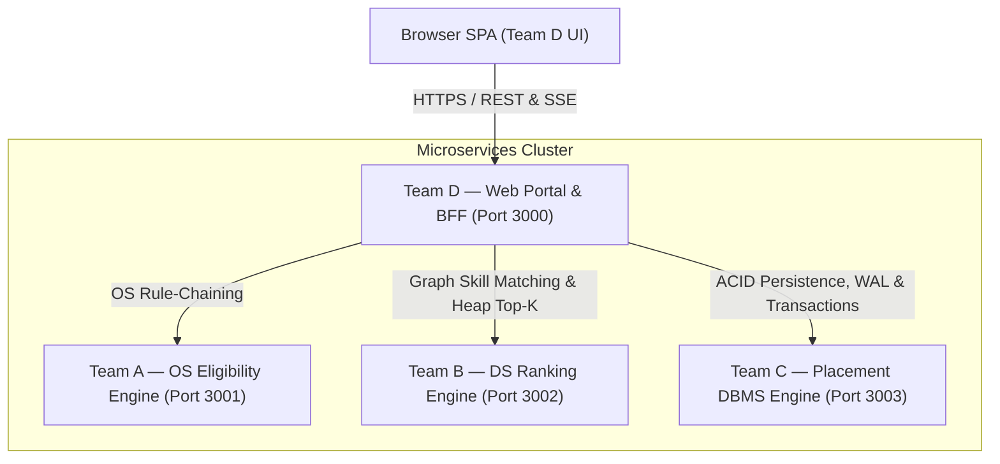

# RIT — Campus Placement & Eligibility System

**Rajarambapu Institute of Technology (RIT)**  
*Rule-Based Placement Eligibility, DS Candidate Ranking & Data-Driven Analytics System*

---

## Executive Overview

The **RIT Campus Placement & Eligibility System** is an enterprise-grade multi-tier microservices platform designed to automate student placement workflows, criteria eligibility evaluations, candidate skill graph rankings, formal offer lifecycles, and institutional analytics for Rajarambapu Institute of Technology.

The platform is engineered around **4 specialized microservices** (Teams A, B, C, and D) operating over standardized REST APIs with distributed tracing (`X-Correlation-ID`) and Server-Sent Events (SSE) real-time outbox streaming.

---

## Architecture & Team Boundaries



### Team Responsibilities

| Service | Domain | Primary Responsibilities | Port |
| :--- | :--- | :--- | :--- |
| **Team A** | OS Eligibility Engine | Decision Tree Rule-Chaining, Slot Lock Manager, Queue Scheduling & Criterion Breakdown | `3001` |
| **Team B** | DS Ranking Engine | Weighted Skill Graph Matching, HeapTopK ($O(N \log K)$), MergeSort & Scoring Telemetry | `3002` |
| **Team C** | Placement DBMS Engine ★ | Single Source of Truth, ACID Storage Engine, Write-Ahead Logging (WAL), SSE Outbox & Audit Logs | `3003` |
| **Team D** | Web Portal & BFF | Glassmorphism UI SPA, Backend-for-Frontend (BFF), Role Security, Analytics, CSV Export & SSE Proxy | `3000` |

---

## Core Technologies & Custom Algorithms

1. **Custom JSON DBMS (Team C)**: Built from scratch without external databases (MongoDB, PostgreSQL, SQLite, etc.). Implements ACID-compliant JSON storage, WAL recovery log, two-phase locking (2PL), idempotency caching, and Server-Sent Events (SSE) outbox mutation streaming.
2. **From-Scratch Data Structures & Algorithms**:
   - **Team A**: OS Decision Tree Rule Evaluator, FIFO Queue Scheduler, Criteria Match Matrix.
   - **Team B**: Weighted Skill Graph Matcher, Min-Heap Top-K Shortlister, Stable MergeSort Candidate Leaderboard.
3. **Frontend & Styling**: Modern Vanilla JS Single Page Application (SPA), HSL dark-mode glassmorphism design system, Outfit typography, responsive CSS grid, ARIA landmark roles, and real-time notification drawer.
4. **Security & Protection**: Server-side RBAC, JWT session handling, rate limiting (`429`), XSS HTML escaping, and CSV formula injection sanitization.

---

## Application State Machine

All application state transitions are strictly governed by Team C's `stateMachineService.js`:

```
APPLIED → SCREENING → RULE_EVALUATED → SHORTLISTED → INTERVIEW_SCHEDULED → SELECTED → OFFER_ISSUED → OFFER_ACCEPTED
                                     ↘ NOT_ELIGIBLE                                          ↘ OFFER_DECLINED
                                     ↘ WAITLISTED                                            ↘ WITHDRAWN
```

---

## Installation & Setup

### Prerequisites

- **Node.js**: `v18.0.0` or higher
- **npm**: `v9.0.0` or higher

### 1. Clone & Install Dependencies

```bash
# Install dependencies across root and microservices
npm install
```

### 2. Environment Configuration

Copy `.env.example` to create your local `.env` configuration:

```bash
cp .env.example .env
```

Default configuration in `.env`:

```ini
NODE_ENV=development
PORT=3000

TEAM_A_URL=http://localhost:3001
TEAM_B_URL=http://localhost:3002
TEAM_C_URL=http://localhost:3003
TEAM_C_STREAM_URL=http://localhost:3003/api/v1/stream

INTERNAL_SERVICE_SECRET=rit_placement_internal_secret_key
JWT_SECRET=rit_placement_jwt_signing_secret

MOCK_MODE=false
```

---

## Running the Project

### Start All Services (Ports 3000–3003)

```bash
npm run start:all
```

### Start Team C Standalone

```bash
npm run start:c
```

### Seed Deterministic Test Data

```bash
npm run seed
```

### Ping Service Health Check

```bash
npm run health
```

---

## API Reference Guide (Team D BFF — Port 3000)

All public endpoints are mounted under `/api/v1/ui`.

| Category | Endpoint | Method | Required Role | Description |
| :--- | :--- | :--- | :--- | :--- |
| **Auth** | `/session` | `POST` | Public | Authenticate user session & return token |
| **Auth** | `/session` | `DELETE` | Authenticated | Logout & invalidate current session |
| **Auth** | `/me` | `GET` | Authenticated | Fetch authenticated user profile & permissions |
| **Students** | `/students/:studentId` | `GET` | Authenticated | Fetch student profile & Placement Readiness Score |
| **Students** | `/students/:studentId` | `PATCH` | Student (Self) / Staff | Update academic metrics, skills, resume PDF |
| **Drives** | `/drives` | `GET` | Authenticated | List placement drives with search & branch filters |
| **Drives** | `/drives/:driveId` | `GET` | Authenticated | Fetch drive details & eligibility criteria |
| **Drives** | `/drives` | `POST` | Admin, Faculty | Create new placement drive |
| **Drives** | `/drives/:driveId` | `PATCH` | Admin, Faculty | Edit placement drive details or state |
| **Eligibility** | `/eligibility/check/:driveId` | `GET` | Authenticated | Team A criteria breakdown comparison |
| **Applications** | `/applications` | `POST` | Student | Submit placement application (Idempotent) |
| **Applications** | `/applications` | `GET` | Authenticated | List applications (Filter by student, drive, state) |
| **Applications** | `/applications/:id/shortlist` | `POST` | Admin, Faculty | Shortlist application candidate |
| **Applications** | `/applications/:id/interviews` | `POST` | Admin, Faculty | Schedule/update interview round details |
| **Applications** | `/applications/:id/offer` | `POST` | Admin, Faculty | Issue formal placement offer with CTC package |
| **Applications** | `/applications/:id/offer-decision` | `POST` | Student (Self) | Student accepts (`ACCEPT`) or declines offer |
| **Rankings** | `/rankings` | `GET` | Authenticated | Fetch Team B candidate leaderboard (Anonymized for students) |
| **Rankings** | `/rankings/preview` | `POST` | Admin, Faculty | Re-evaluate candidate rankings with custom weights |
| **Notifications** | `/notifications` | `GET` | Authenticated | List recipient-isolated notifications & unread count |
| **Notifications** | `/notifications/:id/read` | `PATCH` | Authenticated | Mark notification as read |
| **Stream** | `/stream` | `GET` | Public | Server-Sent Events stream relaying live outbox updates |
| **Analytics** | `/analytics` | `GET` | Admin, Faculty, TPO | Institutional analytics, KPIs, pipeline, CTC package stats |
| **Reports** | `/reports/placement-performance` | `GET` | Admin, Faculty, TPO | Placement performance report & telemetry benchmarks |
| **Reports** | `/reports/export` | `GET` | Admin, Faculty, TPO | Export performance reports in CSV or JSON format |
| **Audit** | `/audit` | `GET` | Admin, Auditor | Query append-only audit trail logs |
| **System** | `/system` | `GET` | Public | Microservices cluster health & latency telemetry |

---

## Role-Based Access Control (RBAC) Matrix

| Action / Endpoint | Student | Faculty / TPO | Admin | Auditor |
| :--- | :---: | :---: | :---: | :---: |
| View Active Placement Drives | ✅ | ✅ | ✅ | ✅ |
| Check Own Eligibility Breakdown | ✅ | ✅ | ✅ | ✅ |
| Apply for Placement Drive | ✅ (Self) | ❌ | ❌ | ❌ |
| View Own Application / Standing | ✅ (Self) | ✅ | ✅ | ✅ |
| Anonymized Candidate Leaderboard | ✅ | ✅ (Unredacted) | ✅ (Unredacted) | ✅ |
| Shortlist Candidate | ❌ | ✅ | ✅ | ❌ |
| Schedule / Update Interview Round | ❌ | ✅ | ✅ | ❌ |
| Issue Formal Placement Offer | ❌ | ✅ | ✅ | ❌ |
| Accept / Decline Personal Offer | ✅ (Self) | ❌ | ❌ | ❌ |
| Create / Edit Placement Drive | ❌ | ✅ | ✅ | ❌ |
| Institutional Analytics & Reports | ❌ | ✅ | ✅ | ❌ |
| Export CSV / JSON Reports | ❌ | ✅ | ✅ | ❌ |
| Query Immutable Audit Trail | ❌ | ❌ | ✅ | ✅ |
| Monitor Service Health & Telemetry | ✅ | ✅ | ✅ | ✅ |

---

## Testing & Quality Assurance

The project includes an extensive automated test suite covering unit, integration, RBAC security, analytics, and workflow scenarios.

### Run All Portal & BFF Tests

```bash
npm test --prefix services/team-d-portal
```

### Complete Test Results

```
PASS tests/security.test.js
PASS tests/portal.test.js
PASS tests/analytics.test.js
PASS tests/notifications.test.js
PASS tests/lifecycle.test.js
PASS tests/rankings.test.js
PASS tests/workflow.test.js
PASS tests/students.test.js
PASS tests/applications.test.js
PASS tests/auth.test.js
PASS tests/drives.test.js
PASS tests/dashboard.test.js
PASS tests/error_handling.test.js
PASS tests/e2e_integration.test.js

Test Suites: 14 passed, 14 total
Tests:       120 passed, 120 total
Snapshots:   0 total
Time:        7.922 s
```

---

## Mock Mode vs Live Production Mode

- **Live Mode (`MOCK_MODE=false`)**: Team D BFF proxies requests directly to Team A (3001), Team B (3002), and Team C (3003). Upstream service errors return structured `503 Service Unavailable` or degraded indicators without swallowing errors.
- **Mock Mode (`MOCK_MODE=true`)**: In-memory adapters (`mockTeamA`, `mockTeamB`, `mockTeamC`) supply deterministic sample data for frontend development and offline testing.

---

## Deployment Prerequisites

To deploy in a production environment:

1. Deploy microservices (`team-a-eligibility`, `team-b-ranking`, `team-c-placement`, `team-d-portal`) as Node.js systemd daemons or containerized services.
2. Configure a reverse proxy (e.g. NGINX) for SSL/TLS termination and port routing.
3. Supply secure production environment variables for `INTERNAL_SERVICE_SECRET` and `JWT_SECRET`.
4. Ensure persistent disk access for Team C's JSON storage directory (`services/team-c-placement/src/db/data/`).

---

## License & Credits

Developed for **Rajarambapu Institute of Technology (RIT)** — Department of Computer Science & Engineering. Academic Year 2026–27.
